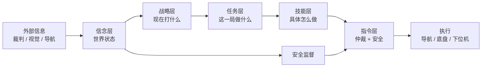

# 项目概览：RM27 哨兵决策系统

> 这是一份面向「第一次接触这个项目的人」的设计记录：讲清楚系统为什么这样拆、每一块负责什么、
> 和旧版相比好在哪、接下来往哪走。它不追求技术细节，真正的接口与实现以
> [ARCHITECTURE.md](ARCHITECTURE.md)、[INTERFACES.md](INTERFACES.md) 为准。

## 1. 这个项目解决什么问题

哨兵机器人每场比赛要同时处理很多事：读裁判系统给的信息、判断现在该进攻还是防守、决定去哪里、
什么时候买弹、什么时候复活。这些事如果写成一长串 if-else，改一个地方就容易碰坏另一个地方，
也没法回答「为什么刚才做了那个决定」。

这个项目的目标，是把「从信息到动作」的过程拆成清晰的几段：

**先认识世界，再决定做什么，再检查能不能做，最后才发指令。**

每一段都可以单独替换、单独测试、单独观测。一句话概括：

> 决策不是「写死一套打法」，而是「搭一套能换打法的骨架」。

## 2. 整体框架



可以把它想成一条流水线：

1. **信念层**把来自不同来源、不同频率的信息，整理成一份「当前世界」；
2. **战略层**只回答「现在是什么打法、用什么姿态」；
3. **任务层**把打法拆成具体任务，例如打前哨、守家、撤退；
4. **技能层**把任务拆成可复用的动作，例如去某个点、巡逻、兑换；
5. **指令层**在多个请求之间做裁决，做限幅和急停，最后只输出一套动作。

安全监督不在这条线的末端，而是全程参与：它可以直接否决或改写任何输出。

## 3. 分模块介绍

### 3.1 通信：把「车说的话」翻译成「决策能懂的世界」

系统由两个仓库组成：

- **决策仓库**（本项目）：只关心「世界是什么样、应该做什么」；
- **auto-aim 仓库**：负责视觉、串口和与下位机（MCU）的实际收发。

两者通过一组固定的 ROS 消息连接。这样做的边界很明确：**决策永远不直接碰串口**，
换串口、换波特率、换 MCU 协议，都不会影响决策逻辑。

**上行**是四类信息：比赛阶段与经济、自身状态、场地事件、队友 / 建筑状态
（其中自身视觉与电容部分由本机提供，不经过裁判系统）。它们会先经过统一的位段解码，
再进入信念层，而不是在决策代码里到处写位运算。

**下行**有三类：导航目标（交给 Nav2）、底盘速度、资源动作（买弹、兑换、复活）。
资源动作走一条独立的「决策 → auto-aim → 串口 → MCU」链路。

串口协议 v1 的几个设计点：

- 统一帧格式：魔数 + 版本 + 类型 + 长度 + 载荷 + 校验，和旧帧共用同一串口；
- 带版本号，以后加字段不需要再发明一种帧；
- 带 CRC 校验，坏帧直接丢弃，不会把半截数据当成命令；
- MCU 只做「转发」：把上位机的决定写到裁判系统对应的位置，不负责判断成功与否。

**关于回执（ack）的取舍。** 早期版本让 MCU 执行后回一条「成功/失败」，决策侧再消费。
实践下来发现：这要求 MCU 理解每个动作的语义，也要求上下位机维护同一套状态机，
链路长、状态多，而真正权威的「是否生效」其实在裁判系统里。

所以现在采用更简单的模型：

```text
决策发命令 → 等一小段时间 → 用裁判数据检查是否生效 → 没生效就重发（有次数上限）
```

好处是 MCU 只负责转发，不需要回传、不需要判断。关键是裁判协议本身按「总量」结算：
0x0120 的兑换字段是「本场累计值」，同一个目标重复下发不会重复扣费，所以重试天然幂等。
决策侧只需为每个动作定义「什么叫生效」，并设置等待时间与重试上限——这部分已经落地。

### 3.2 底层框架：让每一层都能单独替换、单独测试

项目基于 **ROS 2** 和 **BehaviorTree.CPP v4**，但核心逻辑刻意不依赖 ROS。

代码按职责拆成几个包：

| 包 | 负责什么 | 特点 |
| --- | --- | --- |
| `sentry_decision_core` | 数据契约、信念、仲裁、安全、日志 | 纯 C++，不依赖 ROS，可直接单测 |
| `sentry_decision_io` | 所有 ROS 订阅 / 发布 / action | 只做适配，不写决策逻辑 |
| `sentry_decision_nodes` | 行为树节点插件 | 只读写数据契约，不直接调 ROS |
| `sentry_decision_sim` | 裁判仿真、伪导航、场景脚本 | 不装车也能跑完整流程 |
| `sentry_decision_viz` | 树状态、Groot2、网页面板 | 让决策过程看得见 |
| `sentry_interfaces` | 与 auto-aim 的接口约定 | 跨仓库的唯一契约 |
| `sentry_decision_bringup` | 入口、launch、配置加载 | 把各模块组装起来 |

三个关键约定：

1. **单向依赖**：上层可以调用下层，下层绝不反写上层；`core` 不知道 ROS 的存在。
2. **数据契约**：模块之间传的是结构化的 `WorldState` / `Intent` / `DecisionOutput`，
   而不是旧版那种散落在行为树端口上的字符串。
3. **配置即数据**：地图、点位、阈值、超时、模块开关全部放在 `config/` 下的 YAML 里；
   缺一个键就启动失败，不会静默用默认值。

行为树也按「小树」组织：任务树、技能树各自有独立的 ID，可以单独加载、单独测试，
而不是一整棵几百个节点的大树。功能模块编译成共享库，通过清单开关，新增模块不需要改主流程。

### 3.3 上层决策：从「世界」到「动作」

**信念层**是决策唯一信任的世界状态。每个字段都带时间戳和有效期，超时即失效；
关键来源没有到齐时，系统会认为世界未知，而不是把缺失字段当成 0。
这条规则避免了「没收到血量消息 → 以为自己是 0 血 → 误触发撤退」这类事故。

**战略层**只回答两个问题：现在是什么战术模式（进攻 / 防守 / 撤退 / 回血 / 复活 / 待机），
以及用什么姿态。它是一个纯 C++ 组件，在行为树之前求值。以后想换成效用打分或学习模型，
只需要替换这一个实现，下面的任务和技能不用动。

**任务层**根据战略结论选择任务并拆解步骤，例如「打敌方前哨」「回防基地」「回补给区恢复」。
它只做条件判断和子树组合，不写死坐标，也不直接产生动作。

**技能层**是可复用的原子行为：去某个命名点、巡逻、等待恢复、请求兑换。
它只发出「意图」，不关心这个意图最后会不会被采纳。

**指令层**把来自战略、任务、技能、安全等多个来源的意图，按字段做仲裁：
同一个字段最后只能有一个赢家，冲突会被记录和观测。仲裁之后再做速度限幅、
急停判定和超时降级，最后形成唯一一份可执行的输出。

这样分层带来的直接好处是：**换打法只改战略和任务，换执行只改技能和 IO，
换硬件只改 IO 和通信**，三者互不牵扯。

### 3.4 安全：任何自动决策都必须能被叫停

安全在这个系统里不是事后补丁，而是和决策同级的一等公民：

- 裁判数据或里程计超时，直接触发急停；
- 仲裁保证同一字段只有一个来源生效，不会出现两套指令打架；
- 所有速度指令在输出前统一限幅；
- 人工干预走「战术层覆盖」这个受控入口，并且带租约，过期自动失效，
  不能绕过安全监督。

换句话说：**自动决策可以错，但不能错得无法收回。**

### 3.5 仿真与观测：不装车也能把整场跑完

决策系统最难调试的地方，是「比赛只有一次，错了没法重来」。所以项目把仿真和观测做成了基础设施：

- 一条命令启动本地仿真：裁判仿真 + 行为树 + 网页面板，不需要真实机器人；
- 场景脚本可以按时间轴修改世界（掉血、占点、经济变化），并对决策结果做断言；
- 支持从 rosbag 回放：只凭录制数据就能确定性复现一场比赛；
- 决策状态、树节点状态、意图冲突都可以实时看到，也支持 Groot2 观察行为树；
- 双仓库联调时可以额外拉起真实导航，验证完整链路。

这让大多数逻辑问题在装车之前就能暴露，而不是等到赛场上。

## 4. 与旧版相比，新在哪里

旧仓库 `sentry_DecisionMaking` 也能跑，但决策逻辑大量散在行为树 XML、字符串端口和全局状态里，
改一处很难判断影响面，也很难脱离整车测试。新版本参考了分层决策的设计，重新组织了一遍：

| 维度 | 旧版 | 现在 |
| --- | --- | --- |
| 决策组织 | 逻辑散在 XML 与全局状态 | 信念 → 战略 → 任务 → 技能 → 指令，分层明确 |
| 模块接口 | 字符串端口、隐式约定 | 结构化数据契约，编译期可检查 |
| 与 ROS 的关系 | 决策与 ROS 绑在一起 | 核心逻辑不依赖 ROS，可独立编译测试 |
| 可测试性 | 基本只能装车跑 | 每层可单测，仿真可跑完整场景 |
| 可回放性 | 难以复现 | 录制数据可确定性重放 |
| 参数管理 | 硬编码、散落 | 全部外置 YAML，缺项启动即失败 |
| 行为树 | 一棵大树 | 多棵可独立加载的小树 + 插件式模块 |
| 安全 | 分散的判断 | 独立的安全监督 + 统一仲裁 + 急停 |
| 可观测性 | 靠日志猜 | 决策状态、树状态、Groot2、网页面板 |
| 通信边界 | 决策直接面对串口细节 | 决策不碰串口，auto-aim 独占 |

## 5. 主要优点

- **改得动**：新增打法主要改战略和任务，不需要动通信和执行。
- **测得动**：核心逻辑是纯 C++，行为树节点只读写数据，绝大多数问题可以在宿主机上测出来。
- **查得动**：每个决策都能回答「当时世界是什么、谁提了什么意图、谁赢了、为什么」。
- **敢让人碰**：配置有校验、接口有契约、安全有兜底，新同学改错一层不容易把整车带崩。
- **换硬件不伤筋动骨**：串口协议、导航实现、视觉来源都被隔离在 IO / 通信层。

## 6. 当前状态与未来计划

当前版本 **v0.5.1**：决策与 auto-aim 的 ROS 链路已经打通，auto-aim 侧完成了协议 v1 的收发，
回执已取消、改为用裁判数据校验生效并重试；本地仿真、场景脚本、网页面板和回放都已可用。下一阶段：

1. **实车联调**：与导航仓库一起跑通真实场地，校准点位、超时和安全阈值。
2. **MCU 侧实现协议 v1**：完成裁判上行转发和资源动作执行。
3. **通信简化（已完成）**：去掉回执，改为「发累计目标值 → 用裁判数据验证 → 失败重试」，
   生效判据、等待时间和重试上限已写入配置。
4. **接入更多信息**：视觉锁定目标、队友状态、更完整的场地事件。
5. **战略层演进**：从规则状态机逐步过渡到效用打分，保留回放评估能力。
6. **数据驱动**：用比赛回放做策略对比，让「改参数」变成「有依据的调参」。

## 7. 从哪里开始读

| 想了解 | 看这里 |
| --- | --- |
| 怎么构建、怎么跑 | [README.md](../README.md)、[USAGE.md](USAGE.md) |
| 怎么用仿真和面板 | [SIMULATION.md](SIMULATION.md) |
| 系统技术设计 | [ARCHITECTURE.md](ARCHITECTURE.md) |
| 世界状态有哪些字段 | [BELIEF.md](BELIEF.md) |
| 与 auto-aim 的接口 | [INTERFACES.md](INTERFACES.md) |
| 开发进度与计划 | [ROADMAP.md](ROADMAP.md)、[NOTE.md](NOTE.md) |
